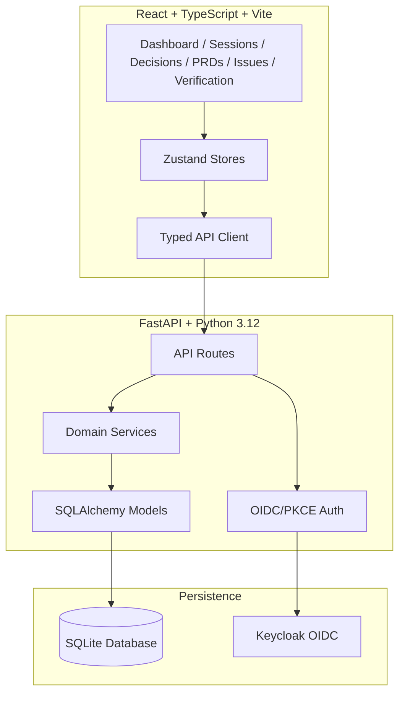

# Cobalt Forge — Alan Vo

> Work in progress. This checkpoint may be incomplete or fail tests. See PLAN.md and STATUS.md before use.


**Alan Vo | AI & Machine Learning**

Cobalt Forge is a traceable engineering workflow platform that solves the problem of lost decisions across the development lifecycle. It implements a complete workflow: **Grilling → Decision Ledger → PRD → Issues → Implementation → Verification** with bidirectional traceability.

## The Problem

Engineering teams lose critical decisions during handoffs between grilling sessions, PRD creation, issue tracking, and implementation. As the number of questions grows, summarization and paraphrasing accumulate—explicit constraints, negative requirements, edge cases, numerical defaults, and ordering decisions are especially easy to soften or omit. The resulting PRD can still look complete while implementation has drifted from decisions the user already made.

## The Solution

Cobalt Forge maintains a **Decision Ledger** with stable IDs, versioned records, and bidirectional traceability:

1. **Grilling Sessions** — Interactive design-tree interviews with frontier gate and pivot-first ordering
2. **Decision Records** — Each resolved answer gets a stable ID (DEC-001, DEC-002...), normalized testable requirement, and explicit constraints
3. **PRD Generation** — Automatically maps every decision to user stories, constraints, and acceptance criteria with coverage reporting
4. **Issue Tracking** — Generates issues from PRD covering all decisions, tracks frontier (unblocked issues), and marks completion with commit references
5. **Verification** — Links test results, code reviews, and commits back to decisions with coverage reports

## Key Features

- **Frontier Gate & Pivot Ordering** — Only asks decisions whose prerequisites are settled; tree-reshaping decisions first
- **Assumption Tracking** — Records assumptions with veto capability for transparency
- **Explicit Exit Gate** — Requires typed "confirmed" before implementation
- **Versioned Decisions** — Full history when decisions are revised
- **Coverage Reports** — Know exactly which decisions are covered, missing, or stale
- **OIDC Authentication** — Secure PKCE flow with Keycloak, SAML broker ready
- **Provider-Agnostic LLM** — Optional AI assistance with OpenAI-compatible, Anthropic, Gemini, Ollama adapters

## Quick Start

### Prerequisites

- Python 3.12+
- Node 24+
- Docker & Docker Compose (optional)

### Local Development

1. **Clone and configure**
   ```bash
   git clone https://github.com/ALANDVO/cobalt-forge-alan-vo
   cd cobalt-forge-alan-vo
   cp .env.example .env
   ```

2. **Start with Docker Compose** (includes Keycloak)
   ```bash
   docker compose up -d
   ```
   - Backend: http://localhost:8000
   - Frontend: http://localhost:3000
   - Keycloak: http://localhost:8080 (admin/admin)

3. **Or run locally**
   ```bash
   # Backend
   python -m venv .venv
   .venv/bin/pip install -r backend/requirements.txt
   .venv/bin/python -m uvicorn app.main:app --reload --host 127.0.0.1 --port 8000

   # Frontend (separate terminal)
   cd frontend
   npm install
   npm run dev
   ```

### Demo Mode

The app includes a demo mode that creates a local user without requiring Keycloak. Just visit http://localhost:3000 and click "Continue as Demo User".

## Architecture



## API Endpoints

### Sessions
- `POST /api/v1/sessions` — Create grilling session
- `GET /api/v1/sessions` — List sessions
- `GET /api/v1/sessions/{id}` — Get session with rounds/questions
- `POST /api/v1/sessions/{id}/rounds` — Start new round
- `GET /api/v1/sessions/{id}/prepare-round` — Get frontier questions (pivot-first)

### Questions & Assumptions
- `POST /api/v1/rounds/{id}/questions` — Add question
- `POST /api/v1/questions/{id}/answer` — Answer question (creates decision record)
- `POST /api/v1/rounds/{id}/assumptions` — Add assumption
- `POST /api/v1/assumptions/{id}/veto` — Veto assumption

### Decisions
- `POST /api/v1/decisions` — Create decision record
- `GET /api/v1/decisions` — List decisions
- `GET /api/v1/sessions/{id}/coverage` — Decision coverage report

### PRDs
- `POST /api/v1/prds` — Create PRD
- `POST /api/v1/prds/{id}/generate` — Generate from decisions
- `POST /api/v1/prds/{id}/finalize` — Finalize PRD
- `GET /api/v1/prds/{id}/coverage` — Traceability coverage

### Issues
- `POST /api/v1/issues` — Create issue
- `GET /api/v1/issues` — List issues
- `PATCH /api/v1/issues/{id}/status` — Update status
- `POST /api/v1/issues/{id}/complete` — Mark done with commit SHA
- `GET /api/v1/prds/{id}/frontier` — Get unblocked issues
- `POST /api/v1/prds/{id}/generate-issues` — Generate from PRD

### Verification
- `POST /api/v1/evidence` — Add verification evidence
- `GET /api/v1/decisions/{id}/evidence` — Get evidence for decision
- `GET /api/v1/verification/coverage` — Verification coverage report

## Configuration

| Variable | Description | Required |
|----------|-------------|----------|
| `DATABASE_URL` | Database connection string | Yes |
| `SECRET_KEY` | JWT signing key | Yes |
| `OIDC_ISSUER_URL` | Keycloak realm URL | Yes |
| `OIDC_CLIENT_ID` | OIDC client ID | Yes |
| `OIDC_CLIENT_SECRET` | OIDC client secret | Yes |
| `OIDC_REDIRECT_URI` | Frontend callback URL | Yes |
| `FRONTEND_URL` | Frontend origin for CORS | Yes |
| `LLM_API_KEY` | LLM provider API key | No |
| `LLM_PROVIDER` | Provider: openai-compatible, anthropic, gemini, ollama | No |
| `LLM_MODEL` | Model name | No |
| `LLM_BASE_URL` | Custom API base URL | No |

## AI/ML Evaluation

Cobalt Forge is an **AI/ML developer tool** that implements a decision traceability engine. The core domain engine (decision ledger, grilling workflow, PRD generation, issue tracking, verification) is deterministic and works without any LLM key. LLM explanations are opt-in, labeled advisory, and grounded in actual records.

### Reproducible Baseline

```bash
# Run the test suite to verify decision traceability
.venv/bin/pytest backend/tests -v
cd frontend && npm test
```

### Test Coverage
- Backend: 12+ meaningful tests covering domain logic, boundary conditions, persistence, auth, and API workflows
- Frontend: Component tests for user-visible behavior
- Integration: Cross-boundary tests for create/read workflows

### Limitations
- SQLite for development; PostgreSQL recommended for production
- Demo mode binds to localhost; production requires proper Keycloak setup
- LLM adapters are scaffolded; provider-specific error handling needs completion
- SAML broker configuration documented but not tested in CI

## Deployment

### Docker Production

```bash
# Build images
docker compose -f compose.yaml -f compose.prod.yaml build

# Run with production config
docker compose -f compose.yaml -f compose.prod.yaml up -d
```

### TLS Reverse Proxy

Required for production. Example nginx config:

```nginx
server {
    listen 443 ssl http2;
    server_name forge.example.com;

    ssl_certificate /path/to/cert.pem;
    ssl_certificate_key /path/to/key.pem;

    location / {
        proxy_pass http://localhost:3000;
        proxy_set_header Host $host;
        proxy_set_header X-Real-IP $remote_addr;
        proxy_set_header X-Forwarded-For $proxy_add_x_forwarded_for;
        proxy_set_header X-Forwarded-Proto $scheme;
    }

    location /api/ {
        proxy_pass http://localhost:8000;
        proxy_set_header Host $host;
        proxy_set_header X-Real-IP $remote_addr;
        proxy_set_header X-Forwarded-For $proxy_add_x_forwarded_for;
        proxy_set_header X-Forwarded-Proto $scheme;
    }
}
```

### Backup/Restore

```bash
# Backup SQLite
sqlite3 data/cobalt_forge.db .dump > backup.sql

# Restore
sqlite3 data/cobalt_forge.db < backup.sql
```

### SAML IdP Enrollment

Keycloak supports upstream SAML IdPs through identity brokering:

1. In Keycloak Admin Console → Identity Providers → Add SAML v2.0
2. Configure IdP metadata or manual settings
3. Map attributes (email, name, groups) to Keycloak user attributes
4. Update realm export with broker configuration

## Security Limitations

- Demo mode creates local user without authentication
- OIDC state/nonce stored in sessionStorage (not persistent)
- No rate limiting on auth endpoints (add in production)
- SQLite file permissions not hardened
- LLM API keys only server-side but not encrypted at rest
- No audit logging for admin actions (framework exists)

## License

MIT License — Copyright (c) 2026 Alan Vo <alanvo@gmail.com>

See [LICENSE](LICENSE) for details.